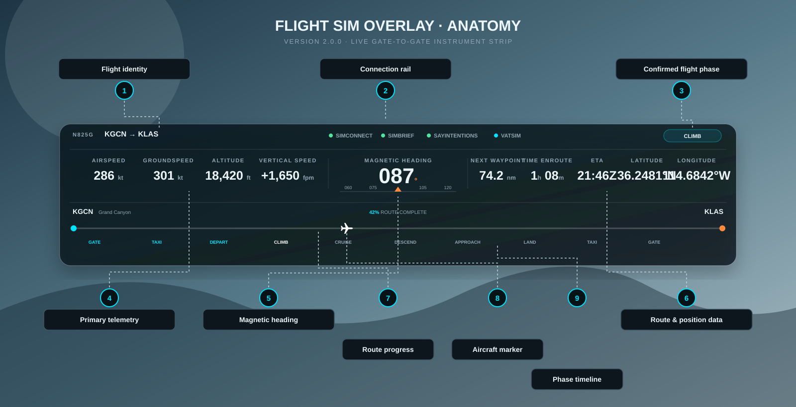

# Flight Sim Overlay

Flight Sim Overlay is a free, local companion overlay for Microsoft Flight
Simulator recordings and live streams. Version **2.0.1** turns the original proof
of concept into a configurable gate-to-gate instrument strip with robust
SimConnect telemetry, flight-plan-aware progress, a settings studio, and a
Windows system-tray controller.



## Overlay anatomy

| # | Component | What it does |
|---:|---|---|
| 1 | Flight identity | Shows the callsign and SimBrief or SayIntentions origin/destination. |
| 2 | Connection rail | Reports SimConnect, SimBrief, SayIntentions, and VATSIM health without covering the instruments. |
| 3 | Flight phase | Displays the confirmed gate-to-gate phase using configurable hysteresis. |
| 4 | Primary metrics | Defaults to airspeed, groundspeed, altitude, and vertical speed. Every metric can be reordered or moved. |
| 5 | Heading instrument | Smooth magnetic heading with correct wrap-around behavior at north. |
| 6 | Secondary metrics | Route, timing, and position data. Coordinates can be hidden as a group. |
| 7 | Route progress | Projects the live SimConnect aircraft position onto the imported SimBrief route. Fill and marker share the same progress value. |
| 8 | Aircraft marker | Choose from six right-facing silhouettes; the marker moves smoothly and never runs backward because of a crossing route leg. |
| 9 | Phase timeline | Shows the complete gate-to-gate lifecycle and highlights the active stage. |

The previous screenshots remain available in [`screenshots/`](screenshots/).

## Highlights

- Ten flight states: at gate → taxiing → departure → climb → cruise → descent →
  approach → arrival → taxiing → at gate
- Position-based route progress using live SimConnect latitude/longitude and
  SimBrief route geometry
- Persistent graphical settings with an embedded live preview
- 15 theme sets, six aircraft markers, transparency from 0–100%, placement,
  scale, smoothing, and metric ordering
- System tray menus for the most common changes
- SimBrief planning, SayIntentions local flight context, and VATSIM pilot status
- Graceful offline/INOP behavior and automatic SimConnect reconnection
- Built-in demo telemetry for setup and stream-scene design

## Requirements

- Windows 10 or 11 for Microsoft Flight Simulator and the system tray
- Python 3.11 or newer
- Microsoft Flight Simulator 2020/2024 with SimConnect available

The overlay itself is ordinary HTML and can be displayed by OBS, Streamlabs, or
another computer on your local network.

## Install

```powershell
git clone https://github.com/teezyyoxo/flight-sim-overlay.git
cd flight-sim-overlay
python -m venv .venv
.\.venv\Scripts\Activate.ps1
python -m pip install -r requirements.txt
Copy-Item .env.example .env
python server.py
```

Normal startup launches a tray icon and serves:

- Overlay: `http://127.0.0.1:5000/overlay`
- Settings: `http://127.0.0.1:5000/settings`
- Health check: `http://127.0.0.1:5000/healthz`

Double-click the tray icon to open settings, or right-click it for themes,
aircraft, transparency, refresh, reset, and status actions.

### Useful launch modes

```powershell
# Animated three-minute gate-to-gate demo
python server.py --demo --open-settings

# Headless/browser-source host without the tray
python server.py --no-tray

# Allow a trusted LAN device to load the overlay
python server.py --host 0.0.0.0
```

Do not expose the service directly to the public internet. The settings API is
intended for a local machine or trusted home network.

## OBS or Streamlabs

1. Start `server.py` on the simulation PC.
2. Add a **Browser Source**.
3. Use `http://127.0.0.1:5000/overlay` when streaming on the same PC.
4. Set the source canvas to your output resolution, such as 1920×1080.
5. Leave custom CSS empty. The page background is transparent.
6. Use the settings studio to position and scale the overlay instead of cropping
   the browser source.

For a separate streaming computer, set `FSO_HOST=0.0.0.0` and use the simulation
PC's private LAN address. Allow port 5000 only on the private network.

## Configuration

Saved settings live in `config/settings.json` and are created automatically after
the first save. The file is ignored by Git, so local preferences survive updates
without entering commits.

The **Reset to defaults…** action is available in both the settings studio and
tray menu. Defaults retain the original dark/cyan/orange character, 30%
transparency, top placement, and familiar telemetry grouping.

### Environment variables

Copy `.env.example` to `.env`. The live `.env` is ignored by Git.

| Variable | Required | Description |
|---|---:|---|
| `FSO_HOST` | No | Bind address. Defaults to the safer `127.0.0.1`. |
| `FSO_PORT` | No | Web port; defaults to `5000`. |
| `FSO_CONFIG_PATH` | No | Persistent JSON settings path. |
| `SIMBRIEF_USER_ID` | For SimBrief | Numeric SimBrief user ID. May instead be entered in settings. |
| `SIMBRIEF_USERNAME` | Alternative | SimBrief username when no numeric ID is supplied. |
| `SIMBRIEF_API_URL` | No | Official fetcher endpoint; normally leave unchanged. |
| `SAYINTENTIONS_FLIGHT_URL` | No | Supported local `flightJSON` endpoint. |
| `SAYINTENTIONS_FLIGHT_JSON` | No | Windows file fallback when the local HTTP endpoint is unavailable. |
| `SAYINTENTIONS_API_KEY` | No | Optional manual SAPI key. Auto-discovery is preferred. |
| `VATSIM_DATA_URL` | No | VATSIM public live-data endpoint. |

This workstation's live `.env` is already populated with its localhost host,
port, settings path, and discovered SayIntentions file location. A SimBrief ID
was not guessed; add the actual account ID in the settings studio.

## Integration behavior

### SimBrief

Enter a user ID or username and choose **Force-refresh flight plan** after
generating a new OFP. The app caches the plan, extracts its route polyline, and
uses live SimConnect coordinates to place the progress marker. SimBrief's fetcher
does not require an API key for this use.

### SayIntentions.AI

When the Windows client is running, the app reads
`http://localhost:63287/flightJSON`, the companion endpoint documented by
SayIntentions. It can display the current callsign, airports, runway, clearance,
and assigned gate. An API key found in that payload stays in server memory and is
never included in a response to the overlay or settings page.

### VATSIM

VATSIM status uses the network's public v3 data feed. Supply the flight callsign
in settings; when blank, the app uses the active SimBrief callsign when possible.

## Flight-phase inference

The phase detector uses synchronized live telemetry: on-ground state, ground
speed, AGL, altitude, vertical speed, parking brake, engine state, planned cruise
altitude, and route position. Transitions must remain valid for the configured
confirmation period. Directional state rules prevent a single noisy sample from
jumping backward through the flight while still allowing a go-around.

Tune thresholds under **Flight behavior** for helicopters, STOL aircraft, or
unusual operating profiles.

## Troubleshooting

- **Tray icon is missing:** reinstall with `python -m pip install -r
  requirements.txt`, then restart without `--no-tray`.
- **SimConnect says “Waiting”:** start MSFS and load into a flight. The server
  can start first and reconnects automatically.
- **Values show INOP:** check `/healthz`, then enable Demo telemetry in settings
  to distinguish an overlay issue from a SimConnect issue.
- **SimBrief says “Import failed”:** generate a new OFP and verify the exact user
  ID or username.
- **SayIntentions says “Client not detected”:** start its Windows client and an
  active flight, then verify the `.env` URL/file values.
- **Settings look corrupted:** use **Reset to defaults…**. Invalid and
  out-of-range values are also sanitized on load.

## Development

```powershell
python -m pip install -r requirements-dev.txt
pytest
python server.py --demo --no-tray
```

See [CHANGELOG.md](CHANGELOG.md) for the complete v2.0.0 change record.

## Credits

Original project by [@teezyyoxo](https://github.com/teezyyoxo), with the earlier
visual redesign credited to [@jocxfin](https://github.com/jocxfin).

Keep the blue side up. ✈
